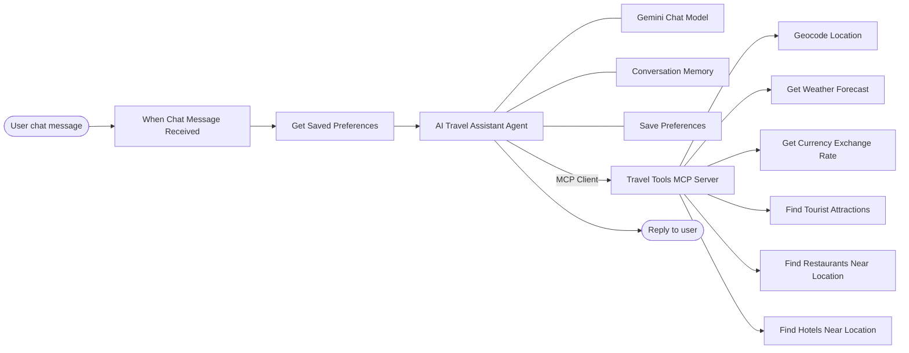

# MCP AI Travel Assistant (n8n)

An AI travel assistant built in **n8n** with two cooperating workflows:

1. **Travel Data MCP Server**: exposes live travel data (geocoding, weather, currency, attractions, restaurants, hotels) as tools through an **MCP Server Trigger**.
2. **MCP AI Travel Assistant**: a chat-driven **AI Agent** (Google Gemini) that remembers the conversation, loads and saves user preferences, and calls the MCP server's tools to answer travel questions with real data instead of guesses.

> The data tools use free, public APIs that need no paid plan. Check each tool node for the exact endpoint and any required keys.

---

## Table of Contents

- [Architecture](#architecture)
- [Workflow 1: Travel Data MCP Server](#workflow-1-travel-data-mcp-server)
- [Workflow 2: MCP AI Travel Assistant](#workflow-2-mcp-ai-travel-assistant)
- [Tech Stack](#tech-stack)
- [Setup](#setup)
- [Example Conversations](#example-conversations)
- [Known Limitations](#known-limitations)
- [Troubleshooting](#troubleshooting)
- [Repository Structure](#repository-structure)

---

## Architecture



The agent never talks to the travel APIs directly. It talks to **one** MCP endpoint, and the MCP server decides which HTTP tool to run. Tools can be added, changed, or reused by other agents without touching the assistant workflow.

---

## Workflow 1: Travel Data MCP Server


A single **Travel Tools MCP Server** trigger node with six HTTP Request tools attached.

| Tool | Method | Purpose | Source |
|------|--------|---------|--------|
| **Geocode Location** | GET | Converts a place name into latitude/longitude. Other tools depend on this. | Geocoding API |
| **Get Weather Forecast** | GET | Returns the forecast for given coordinates. | Open-Meteo |
| **Get Currency Exchange Rate** | GET | Returns the exchange rate between two currencies. | Exchange-rate API |
| **Find Tourist Attractions** | GET | Looks up attractions and points of interest for a destination. | Wikipedia API |
| **Find Restaurants Near Location** | POST | Finds restaurants around coordinates. | OpenStreetMap Overpass API |
| **Find Hotels Near Location** | POST | Finds hotels around coordinates. | OpenStreetMap Overpass API |

**Typical tool chain:** `Geocode Location` runs first to get coordinates. Then weather, restaurants, and hotels are called with those coordinates.

---

## Workflow 2: MCP AI Travel Assistant


| Node | Role |
|------|------|
| **When Chat Message Received** | Chat trigger. Starts the workflow each time the user sends a message. |
| **Get Saved Preferences** | Reads the user's stored preferences (for example budget, travel style, favourite cuisine) before the agent runs, so they are available as context. |
| **AI Travel Assistant Agent** | The brain. Decides when to call tools, combines results, and writes the final answer. |
| **Google Gemini Chat Model** | The language model powering the agent. |
| **Conversation Memory** | Keeps recent turns so follow-up questions ("what about next week?") work. |
| **Travel Data Tools (MCP)** | MCP Client tool pointing at the Travel Tools MCP Server from Workflow 1. |
| **Save Preferences** | Tool the agent can call to store new preferences it learns during the chat. |

### How a request flows

1. The user sends a message in the n8n chat.
2. Saved preferences are loaded and passed into the agent's context.
3. The agent decides which MCP tools it needs (geocode, then weather, hotels, etc.).
4. Tool results come back, and the agent writes a grounded answer.
5. If the user states a lasting preference, the agent calls **Save Preferences**.
6. Conversation memory keeps the thread coherent for the next message.

---

## Tech Stack

- **n8n**: workflow automation, AI Agent node, MCP Server Trigger, MCP Client Tool
- **Google Gemini**: chat model for the agent
- **MCP (Model Context Protocol)**: tool interface between agent and data tools
- **Public APIs**: Open-Meteo, Wikipedia, OpenStreetMap Overpass, an exchange-rate API

---

## Setup

### Prerequisites

- An n8n instance (cloud or self-hosted) with the **AI Agent**, **MCP Server Trigger**, and **MCP Client Tool** nodes available
- A **Google Gemini API key** (Google AI Studio)
- Storage for preferences (an n8n Data Table or equivalent) with the columns your preference nodes expect

### Steps

1. **Import both workflows** into n8n (Workflows → Import from file).
2. **Activate Workflow 1 (Travel Data MCP Server).** Open the *Travel Tools MCP Server* node and copy its **Production URL**. An MCP server only serves its production URL while the workflow is active.
3. **Configure the MCP client in Workflow 2.** Open *Travel Data Tools (MCP)* and paste the URL from step 2 into the endpoint field.
4. **Add credentials.** Create a Gemini credential and select it in *Google Gemini Chat Model*.
5. **Connect the preference storage.** Point *Get Saved Preferences* and *Save Preferences* at the same table.
6. **Check the exchange-rate tool.** Open *Get Currency Exchange Rate* and confirm the endpoint and any API key it requires.
7. **Test.** Open the chat panel in Workflow 2 and send a message.
8. **Activate Workflow 2** when you are happy with the results.

---

## Example Conversations

**Planning**
> I'm going to Bangkok next weekend. What's the weather like and what should I see?

Tools used: Geocode Location → Get Weather Forecast → Find Tourist Attractions

**Budget**
> How much is 50,000 BDT in Thai Baht?

Tools used: Get Currency Exchange Rate

**Local options**
> Find mid-range hotels and good restaurants near Sukhumvit.

Tools used: Geocode Location → Find Hotels Near Location → Find Restaurants Near Location

**Preferences**
> I always prefer vegetarian food and budget hotels.

Tools used: Save Preferences (applied automatically in later chats)

---

## Known Limitations

- **Overpass API is a shared public service.** It can time out or rate-limit during busy periods. Hotel and restaurant results depend on OpenStreetMap coverage and are often thin outside major cities.
- **No prices or availability for hotels.** OpenStreetMap lists places, not rates or bookings.
- **Tourist attractions from Wikipedia are encyclopedic**, not ranked by popularity or reviews.
- **Exchange rates** come from a free source and may not be real-time.
- **Memory is short-term.** Conversation memory covers recent turns only; lasting facts must go through Save Preferences.
- **No booking.** The assistant recommends and informs; it does not reserve anything.

---

## Troubleshooting

| Problem | Likely cause | Fix |
|---------|--------------|-----|
| Agent says it has no tools or tool calls fail | Workflow 1 is not active, or the MCP URL is the test URL | Activate Workflow 1 and use the **Production URL** |
| Tool count in the agent differs from the server | Tool list cached or a tool disabled | Re-save the MCP client node and confirm all six tools are connected on the server |
| Hotels/restaurants return empty or error | Overpass timeout or no OSM data nearby | Retry, widen the search radius, or add a fallback API |
| Preferences are not saved | *Save Preferences* not connected or column mismatch | Check the connection and column mapping in the node |
| Gemini errors | Missing or invalid API key, or quota exceeded | Re-check the credential and quota |

---

## Repository Structure

```
.
├── README.md
├── docs/
│   ├── mcp-server-workflow.png
│   └── ai-travel-assistant-workflow.png
└── workflows/
    ├── travel-data-mcp-server.json
    └── mcp-ai-travel-assistant.json
```

> Export both workflows from n8n (⋯ → Download) and place them in `workflows/`.

---

## Author

**ZS ROYAL ENGINEERING**: AI automation and engineering solutions.
GitHub: [zsroyalengineering-dot](https://github.com/zsroyalengineering-dot)
